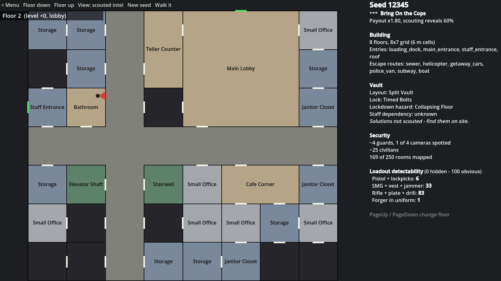

# The Long Con

A realistic 3D tactical heist FPS built in **Godot 4.7**: Payday's heists, Rainbow Six's gadget roles and La Casa de Papel's long, planned operations. Every run happens in a procedurally generated multi-story bank.

The full design is in [docs/BLUEPRINT.md](docs/BLUEPRINT.md).



## Status: prototype foundation

| Area | State |
| --- | --- |
| All gameplay data as JSON (`data/`) | Done: roles, gadgets, weapons, armor, crafting, difficulty, rooms, vaults, civilians, escape routes, penalties, modes, seed config |
| Seeded bank generator | Done and tested: 360 seeds across all 6 star tiers pass validation, about 1.04 attempts per bank |
| Vault solver (at least 2 solutions per lock and hazard) | Done and tested |
| Rule systems (damage, money, detectability, civilians, crafting, breakouts, phases, scouting) | Done as pure logic with unit tests; not yet wired into 3D gameplay |
| Planning table (2D floor plans + scouted intel) | Playable |
| Greybox 3D bank you can walk through | Playable (stairs are interact panels for now) |
| Lobby networking (host/join, roles, seed sync) | Foundation done; host and client verified on localhost |
| Realistic rigged characters (robbers, police, guards, civilians) | Done: 6 CC0 MakeHuman bodies, generated clothing, skin shader, poses with IK; see [docs/CHARACTERS.md](docs/CHARACTERS.md) |
| Player sync, AI, combat in 3D, voice | Not started; see [docs/ROADMAP.md](docs/ROADMAP.md) |

> This game currently lives in the `the-long-con/` folder on the `the-long-con` branch of the `locksystem-server` repo. Its CI is `.github/workflows/the-long-con-ci.yml` at the repo root.

## Run it

1. Install [Godot 4.7](https://godotengine.org/download) (standard build; .NET is not needed).
2. Open Godot, click **Import**, and pick `the-long-con/project.godot`.
3. Press **F5** (Run Project).

In the main menu, choose a seed and a difficulty, then:

- **Planning Table**: floor plans of the generated bank. Use "View" to switch between scouted intel and the full debug view.
- **Character Lineup**: the character models in a studio. Arrow keys orbit, the mouse wheel zooms, R re-rolls.
- **Walk the Bank**: first-person greybox. WASD to move, Shift to sprint, Ctrl to crouch, E to use doors and stairs, M for the map, F5 for a new bank, F1 to return to the menu, Esc to free the mouse.

## Tests

```bash
godot --headless --import                       # first time only
tools/check_all.sh                              # parse-check every script
godot --headless -s res://tests/run_tests.gd    # unit tests
tools/net_smoke.sh                              # host + client on localhost
godot --headless -s res://tools/dump_bank.gd -- 12345 3   # print a bank as text
```

CI (`.github/workflows/the-long-con-ci.yml` at the repo root) runs all of these on every push.

## Layout

```
data/            gameplay data (JSON) - tune the game here
scripts/core/    GameData loader
scripts/gen/     bank generator, validator, vault solver, contents, debug views
scripts/systems/ rule systems (pure logic, unit-tested)
scripts/world/   greybox 3D builder, doors, stairs, sandbox scene
scripts/player/  first-person controller
scripts/ui/      main menu, planning table, floor map
scripts/net/     lobby networking
scripts/autoload DataDB, Events, Session, DevTools, Net
scenes/          main_menu, planning_table, bank_sandbox
tests/           unit tests + network smoke test
tools/           check_all.sh, dump_bank.gd, net_smoke.sh, characters/ (model + texture builders)
docs/            blueprint, architecture, roadmap, decisions, back-at-the-computer checklist
```
