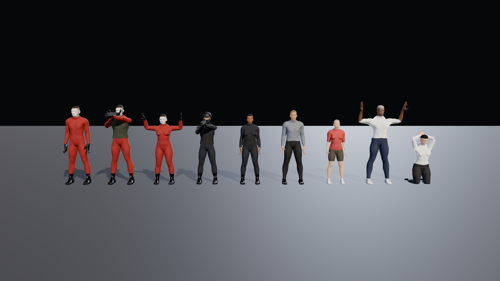

# Characters



## What they are

Realistic, rigged human models built from **MakeHuman** data, which the MakeHuman team released as **CC0** (public domain) in 2020: the base mesh, the 163-bone skeleton, skin weights, and body-shape targets. No attribution or licence fee is needed.

- **6 bodies:** male and female, three ethnic shapes each (`assets/characters/male_a.glb` ... `female_c.glb`), 1.49 to 1.82 m tall.
- **Build variety:** blend shapes `muscular`, `heavy` and `thin` are randomised per character, plus a ±5% height spread.
- **Rig:** the full MakeHuman skeleton (163 bones, including fingers and face), so Mixamo-style retargeted animation can be added later.
- **Clothing:** layers generated from the body surface: jumpsuit, gloves, boots, face-cast porcelain mask, police uniform, balaclava, helmet, plate carrier, shirts, trousers, skirt, shoes and short hair. They are skinned to the same bones, so they move with the body. Skin under clothing is hidden per region to avoid poke-through.
- **Faces:** a custom skin shader (`shaders/skin.gdshader`) with subsurface scattering, pores, lips, eyebrows, stubble and eye-socket shading, plus textured eyes with an iris and pupil.
- **Outfits:** `data/outfits.json` lists outfits, materials, skin tones, hair colours and which civilian type wears what.
- **Poses:** `scripts/characters/character_poses.gd` has stand, hands_up (surrender), kneel_hostage (hands behind head) and aim_rifle, with real two-bone arm IK so hands land on targets.

## Rebuilding

```bash
pip install numpy pillow
python3 tools/characters/build_characters.py     # downloads CC0 sources on first run, writes assets/characters/*.glb
python3 tools/characters/make_textures.py        # procedural detail textures
godot --headless --import
```

Change body mixes in `VARIANTS`, or clothing coverage and thickness in `shells`, inside `build_characters.py`.

## Honest limits, and the path to "AAA realistic"

These are realistic in proportion, anatomy and material, but they are not photoreal. Compared with a commercial character they lack:

| Missing | Fix later |
| --- | --- |
| Loose clothing with folds and wrinkles (clothing is a smoothed layer over the body) | Proper clothing meshes made in Blender or Marvelous Designer, or bought CC0/royalty-free packs |
| Hair cards or strands (current hair is a short cap) | Hair-card assets |
| Painted face texture maps (current faces are procedural) | Scan-based skin textures, e.g. MakeHuman's community skins (check each one's licence) |
| Motion (static poses only) | Mixamo animations retargeted to this skeleton (free with an Adobe account) |
| Real weapon models (the rifle is a box placeholder) | CC0 or purchased weapon models |

The bodies, rig, outfit system, shaders and poses are built so better meshes and textures can be swapped in without changing gameplay code.
